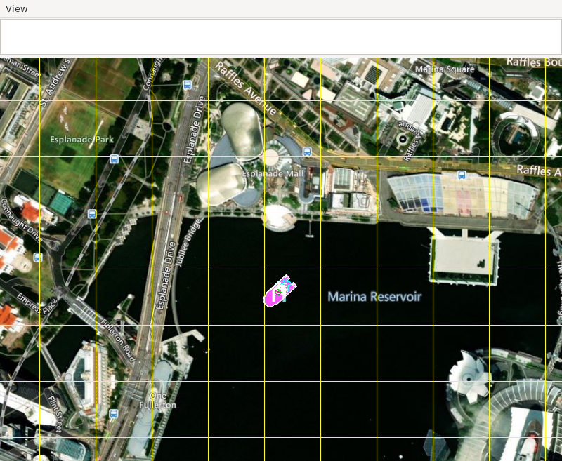
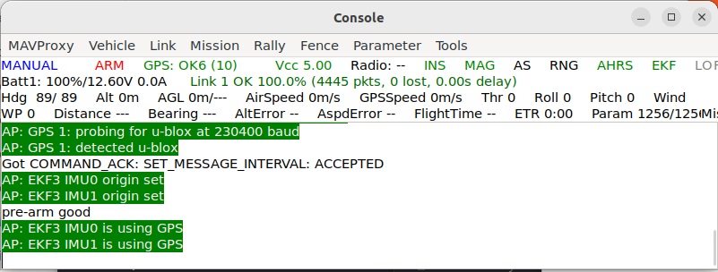
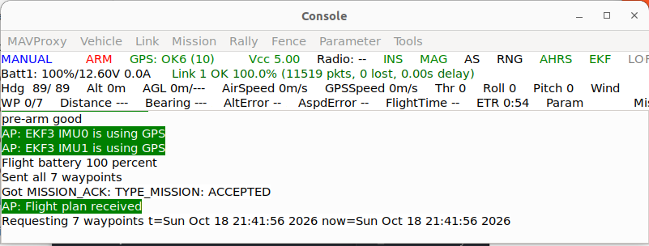
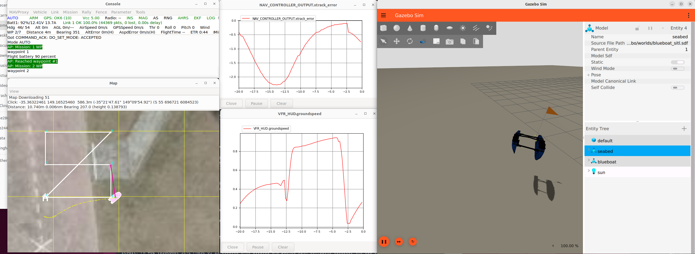
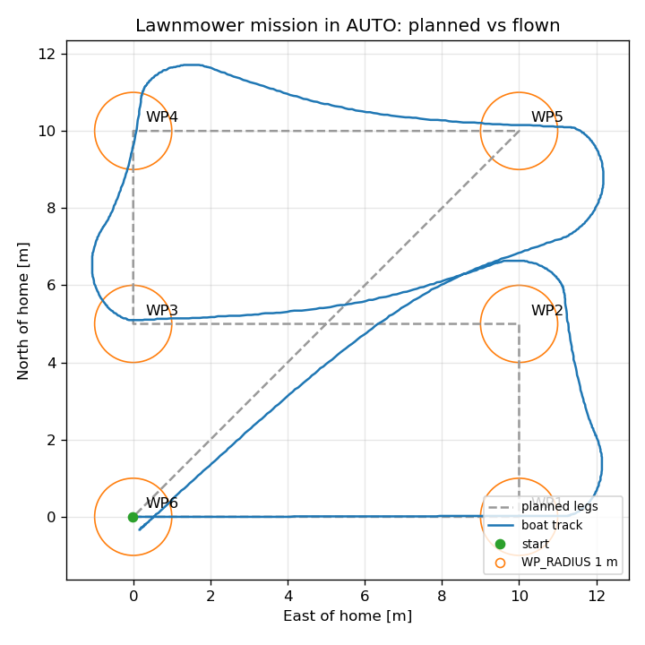
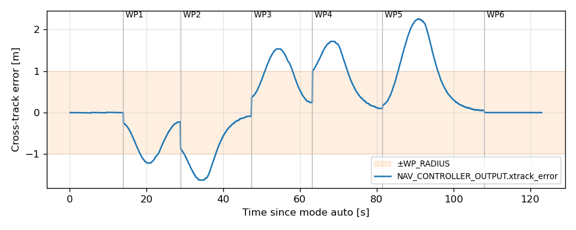
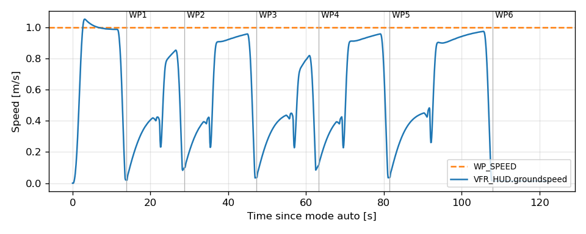

# Waypoint mission for BlueBoat

This walkthrough flies one waypoint mission on the simulated BlueBoat in ArduRover's `AUTO` mode.

`AUTO` is the layer above the stabilization layer exercised in [Tuning of closed-loop response](tune-sitl-boat.md). The waypoint navigator produces a speed and a turn rate, and those go to the same `ATC_SPEED_*` and `ATC_STR_RAT_*` loops. Two things are new. One is the heading controller `ATC_STR_ANG_P`, which the boat reaches when it pivots at a waypoint. The other is the waypoint navigation parameters (`WP_*`, `WP_PIVOT_*`, `PSC_*`), all at Blue Robotics' shipped values.

## Prerequisites

* Setup and run the drydock + source development environment: [installation_drydock.md](../../getting-started/installation_drydock.md)
* [ArduPilot SITL setup](../../getting-started/ardupilot_setup.md);
* [Verify the SITL connection (Boat)](verify-sitl-boat.md) and [Tuning of closed-loop response](tune-sitl-boat.md) pass. If a mission does not run correctly, it is likely issues with the lower feedback control loops.

## The mission

The mission is a fixed file installed with the package, `blueboat_gazebo/missions/lawnmower.waypoints`, in the QGC WPL format that both MAVProxy and QGroundControl read. It is a small lawnmower pattern: 10 m legs east and west, 5 m steps north between them, then a diagonal back to the start.

| Item | North [m] | East [m] | Leg into it |
|---|---|---|---|
| 0 (home) | 0 | 0 | |
| 1 | 0 | 10 | 10 m east, the direction the boat spawns facing |
| 2 | 5 | 10 | 5 m north, after a 90° pivot |
| 3 | 5 | 0 | 10 m west, after a 90° pivot |
| 4 | 10 | 0 | 5 m north, after a 90° pivot |
| 5 | 10 | 10 | 10 m east, after a 90° pivot |
| 6 | 0 | 0 | 14 m diagonal home, after a 135° pivot |

Here is what the waypoints look like in the map.


The waypoints are geodetic (lat/lon/alt), so they make sense where intended against a fixed home location. The walkthrough sets this it with `--custom-location` to ArduPilot's default SITL location, written out so that a change upstream cannot move the mission. Gazebo's +X is east here (`gazeboXYZToNED` in the model), and the boat spawns with its bow along +X, so the first leg starts dead ahead.

Every turn in this mission is sharper than `WP_PIVOT_ANGLE` (45°), so at each waypoint the boat stops and pivots at up to `WP_PIVOT_RATE` (15 deg/s) before setting off down the next leg.

## Walkthrough

All commands are issued within the drydock dev container. Two shells, as in the verification walkthrough.

First, the simulation:

```bash
source ~/maritime_ws/install/setup.bash
source ~/maritime_ws/thirdparty/setup-ardupilot.sh
gz sim -v3 -r $(ros2 pkg prefix --share blueboat_gazebo)/worlds/blueboat_sitl.sdf
```

Then the autopilot, with the map and the pinned home:

```bash
source ~/maritime_ws/install/setup.bash
source ~/maritime_ws/thirdparty/setup-ardupilot.sh
AP=$HOME/maritime_ws/thirdparty/ardupilot/Tools/autotest
sim_vehicle.py -v Rover -f rover-skid --model JSON --console --map -w \
  --custom-location=-35.363261,149.165230,584,90 \
  --add-param-file=$AP/default_params/rover.parm \
  --add-param-file=$(ros2 pkg prefix --share blueboat_gazebo)/params/blueboat_sitl.params
```

Wait until the console reports `EKF3 IMU0 is using GPS`, about 40 s after start. If you try to send a mission earlier is refused.



### Load the mission

At the MAVProxy prompt (note, you will need to adjust the absolute path to your repo location!):

```
wp load /home/CHANGE_TO_YOUR_USER/maritime_ws/install/share/blueboat_gazebo/missions/lawnmower.waypoints
wp list
```
Expect `Loaded 7 waypoints`, then `Flight plan received` in the console, and the six legs drawn on the map.




### Graph the navigation

```
module load graph
graph NAV_CONTROLLER_OUTPUT.xtrack_error
graph VFR_HUD.groundspeed
```

### Fly it

```
arm throttle
mode auto
```

Then touch nothing. The console reports `Mission: 1 WP`, then `Reached waypoint #1` through `#6`, then `Mission Complete`. The boat then loiters at home (`MIS_DONE_BEHAVE 1`). To stop, `mode manual` and `disarm`.

When running, you should see these windows.   


**Video** of the full mission is here: [YouTube](https://youtu.be/kcPEiLzBE0k)

## What a correct run looks like

SITL steps in lockstep with Gazebo, so the run is deterministic. Repeated runs here agreed to 0.01 m and 0.1 s, and a reviewer should see the same figures, not just similar ones. Times are from `mode auto`.

| Leg | Reached at [s] | Leg time [s] | Peak \|xtrack\| [m] | \|xtrack\| at arrival [m] |
|---|---|---|---|---|
| home → WP1 | 13.9 | 13.9 | 0.01 | 0.00 |
| WP1 → WP2 | 28.8 | 14.9 | 1.2 | 0.25 |
| WP2 → WP3 | 47.3 | 18.5 | 1.6 | 0.09 |
| WP3 → WP4 | 63.2 | 15.9 | 1.5 | 0.26 |
| WP4 → WP5 | 81.5 | 18.3 | 1.7 | 0.10 |
| WP5 → WP6 | 108.0 | 26.5 | 2.3 | 0.06 |

* **Speed.** 1.0 m/s on the first leg, which is the target `WP_SPEED`.   dropping to about 0 at each waypoint for the pivot, then 0.8–0.95 m/s on the later legs before slowing for the next waypoint.  
* **Mission time.** 108 s, all six waypoints reached, `Mission Complete`.
* **End.** The boat holds within 0.4 m of home - loitering

The plots below visualize the data.  The graphs are illustrative; the project does not contain the post-processing source. 







### Assessment

The controller stack can obviously be optimized - as it always can.  However, that is not the point.  The goal is a "digital cousin", simulated closed-loop dyanmics that mimic the actual vessel with the SILT Ardu controller and guidance running.   Because the closed-loop behavior is similar that of the hardware, and SITL uses that real-time code and parameter set, we have reasoanble confidnece that any modifications to the controller in sim, can be evaluted in sim and then seemlessly transitioned to hardware. 

## Troubleshooting

| Observation | What it means |
|---|---|
| `Only 0 items are supported` on `wp load` | sent before ArduPilot was ready; wait for `is using GPS` and load again |
| `No Mission. Can't set AUTO.` | the mission did not load; repeat `wp load` and check `wp list` |
| the boat turns before the first leg | the boat is not spawned facing east, or `--custom-location` was dropped; check the command |
| the boat circles a waypoint and never reaches it | it cannot get inside `WP_RADIUS` (1 m); check the turn-rate loop in [Tuning](tune-sitl-boat.md) |
| the boat arcs through corners at speed instead of stopping | the `WP_PIVOT_*` lines are missing from the parameter file; the firmware default disables pivot turns |
| large, steady cross-track on a leg | the speed or heading loop; re-run [Tuning](tune-sitl-boat.md) before suspecting the navigator |
| times or errors differ from the table | something in the vehicle, the parameters or the firmware version changed; the run is deterministic, so a difference is a change, not noise |
