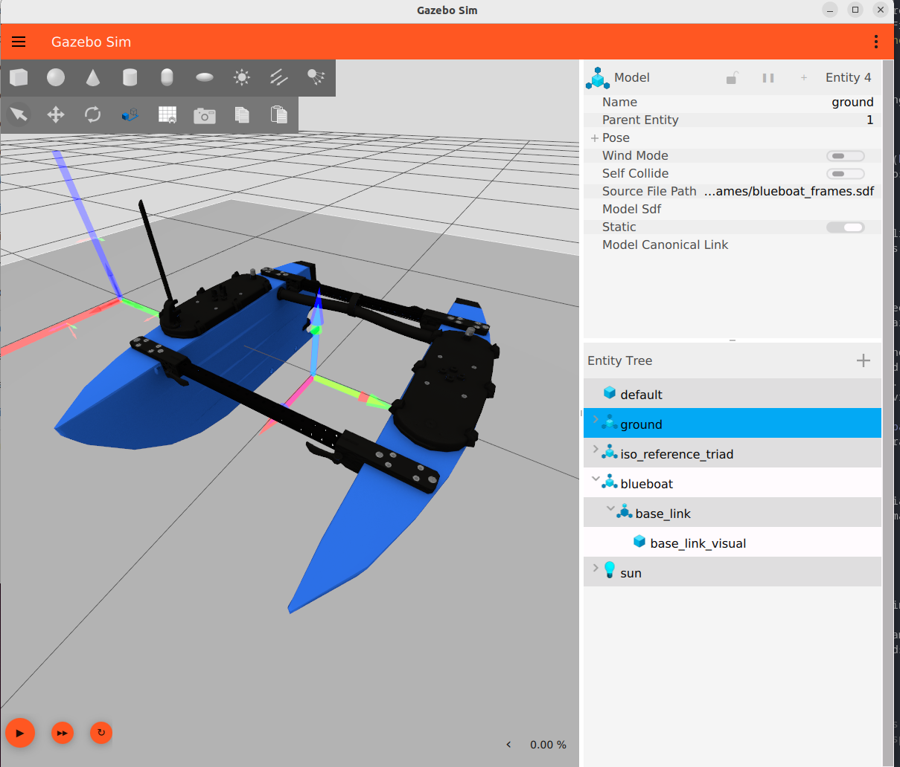
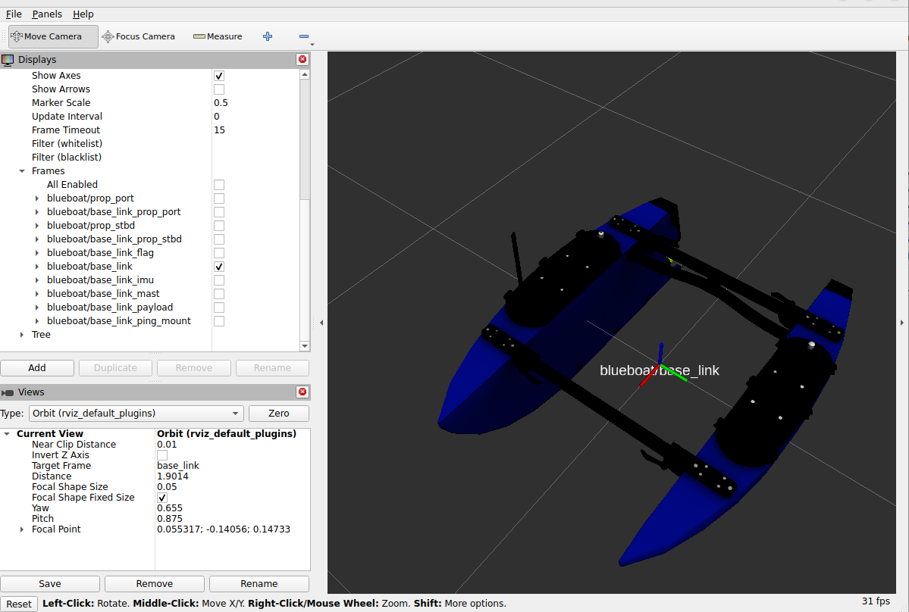

# Running the simulation

```bash
ros2 launch blueboat_gazebo sim.launch.xml
```

Launches the vehicle in its default configuration: every artifact of the
full simulation is generated at start (URDF, composed model, bridge
config, into a directory under `$ROS_HOME`), the model is spawned as
`blueboat` into the water world and the ROS bridge comes up with it. A
`[kdl_parser] root link ... inertia` warning from `robot_state_publisher`
is expected and harmless.

This image shows the visualization of the base_link coordinate system to verify that the visual model has the correct placement and orientation, that the base_link coordinate system origin is located at the correct place, as specified by the datum specification in the part model (see commissioning) and that the orientation of the coordinate system relative the semantic front-left-up convention of ISO and ROS-REP.


This image shows the same scenario with botht the base_link and the base_link_visual coordinate systems.   You can see that the base_link_visual coordinate system complies with the gltf 2.0 convention. 


To run a custom vehicle instead, pass its config with `config_file:=`;
the [configuration page](configuration.md) lists the slots and
[Change the fitted parts](../../how-to/change-parts.md) walks through writing one.

## Launch arguments

| Argument | Default | Meaning |
|---|---|---|
| `config_file` | the shipped config | Vehicle config, expanded at launch. |
| `name` | `blueboat` | Instance name: the Gazebo model name and the topic namespace (`/<name>/...`); letters, digits and underscores. The worlds here float only the default name; see [Several vehicles](../../how-to/namespaces.md). |
| `x`, `y`, `z` | `0`, `0`, the water default | Spawn position (m); the default sits at the waterline. |
| `roll`, `pitch`, `yaw` | `0` | Spawn orientation (rad). |
| `world` | the water world | Vehicle free world SDF to spawn into. |
| `gui` | `true` | Launch the Gazebo GUI. |
| `use_composition` | `true` | Run the server, the bridge and `robot_state_publisher` in one process. |

## Choosing the world

By default the boat is spawned into the open water world
(`blueboat_water.sdf`: graded buoyancy, a seabed at 3 m and a visual
surface). The `world:=` argument swaps the environment without changing
anything else about the simulation: pass any vehicle free world SDF
([Run in your own world](../../how-to/own-world.md)):

```bash
ros2 launch blueboat_gazebo sim.launch.xml world:=/path/my_world.sdf
```

### On the waves

`blueboat_waves.sdf` puts the boat on gz-maritime's wave field instead of
flat water:

```bash
ros2 launch blueboat_gazebo sim.launch.xml \
  world:=$(ros2 pkg prefix --share blueboat_gazebo)/worlds/blueboat_waves.sdf
```

- **Buoyancy follows the waves.** The world runs gz-maritime's wave buoyancy
  (`gz_waves_buoyancy`) in place of gz-sim's graded buoyancy. Each marked
  pontoon segment is floated by the water under the wave surface right above
  it, so the boat heaves, pitches and rolls with the waves.
- **The water moves with the waves.** The boat's own hydrodynamics damps
  against the waves' water velocity as well as the current, so the boat is
  carried back and forth by them. Nothing in the vehicle changes.
- **The sea is a WMO sea state.** It starts at 3 (slight) and can be changed
  while running:

  ```bash
  gz service -s /world/blueboat_waves/wave/set_parameters \
    --reqtype gz.msgs.Param --reptype gz.msgs.Boolean --timeout 2000 \
    --req 'params { key: "sea_state" value { type: INT32 int_value: 5 } }'
  ```

  At sea state 0 the water is still and the boat rests at its static draft,
  as in `blueboat_water.sdf`. Past sea state 6 the waves come out smaller
  than the state says (the wave field's default tile is too short for them).

It needs gz-maritime's `gz_waves_provider_fft`, `gz_waves_rendering` and
`gz_waves_buoyancy` built and on the plugin path. `test_waves` checks the
static draft on still water and the ride at sea state 4.


## In RViz

To see the model in RViz:

```bash
ros2 launch blueboat_description display.launch.xml
```

Starts `robot_state_publisher`, `joint_state_publisher_gui` (sliders to
spin the propellers) and RViz with the packaged config, showing the model
and its frames (parts, slots, the Ping `beam`). It takes the same
`config_file:=` argument, and the xacro is expanded at launch time, so a
custom config needs no rebuild. In a simulation the frames carry the instance name (`blueboat/base_link`)
and joint states arrive as `/blueboat/joint_states`, so RViz next to
`sim.launch.xml` needs its fixed frame, its RobotModel TF prefix and its
joint states pointed at the instance.

Image showing expected RVIZ results with TF frames visualied to show that transforms from gltf 2.0 to RVIZ have resulted in geometry consistent with ISO/ROS-REP coordinate convention.
