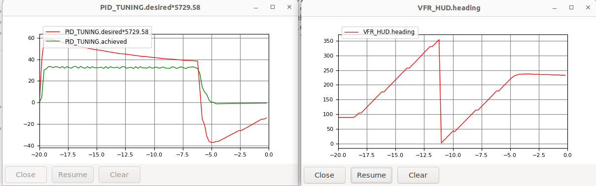
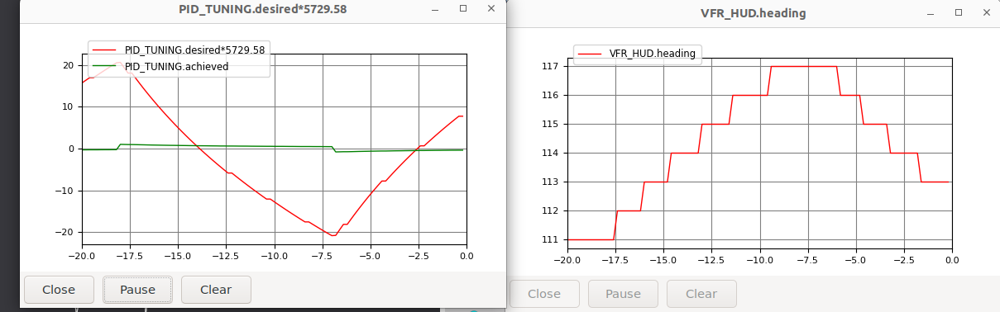
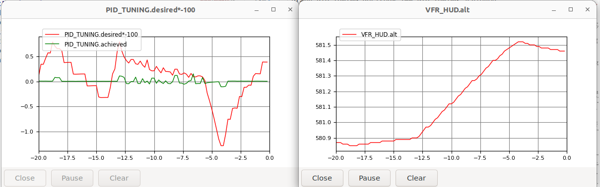
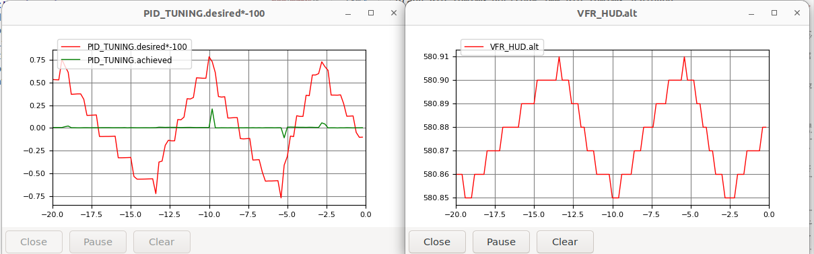

# Tuning of closed-loop response for BlueROV2

This walkthrough is to confirm that ArduSub's inner control loops (stabilization layer) drive the simulated BlueROV2 the way the hardware behaves. `STABILIZE` holds heading, `ALT_HOLD` adds depth.

[Verify the SITL connection (ROV)](verify-sitl-rov.md) checks the ArduSub connections in MANUAL (open-loop) mode.  This should be done prior to this step to verify that the thruster allocation, channels, arming, etc. are working.  

## Prerequisites

* Setup and run the drydock + source development environment: [installation_drydock.md](../../getting-started/installation_drydock.md)
* [ArduPilot SITL setup](../../getting-started/ardupilot_setup.md); (the rest of this page assumes the Iris smoke test passed.)
* [Verify the SITL connection (ROV) for MANUAl ](verify-sitl-rov.md) passes.

## Mode descriptions

* `STABILIZE` can regulate roll, pitch and yaw, but on this vehicle only yaw (heading) is in effect (Blue Robotics ship a roll gain of zero (`ATC_ANG_RLL_P`), and the `Vectored` frame has no pitch actuation). 
* Forward (surge) and lateral (sway) pass straight through, as in `MANUAL`.
* `ALT_HOLD` regulates heading as `STABILIZE` does, and adds depth (z) hold.

The yaw stabilize is implemented in ArduSub (`ArduSub/mode_stabilize.cpp`; `mode_althold.cpp` repeats it) as follows:

* **Stick deflected: a rate.** Outside the yaw channel's dead zone, the stick sets a yaw-rate target (stick angle × `ACRO_YAW_P`).  This setupoint is the input to the yaw-rate `ATC_RAT_YAW_*`
* **Stick released: a bearing.** When the rc command returns to 1500 ± the dead zone (`RC4_DZ`, scaled by the pilot gain), ArduSub commands zero yaw rate for 250 ms to brake the turn, re-reading the heading every cycle. The heading at the end of that window is latched and held. The delay stops the vehicle bouncing back after a fast turn.
* **Holding the bearing: a cascade.** The heading error goes through `ATC_ANG_YAW_P` alone, a proportional-only outer loop (a square-root controller limited by `ATC_ACCEL_Y_MAX`), which produces a yaw-rate target for the same `ATC_RAT_YAW_*` PID. Any integral action comes from the inner loop's `ATC_RAT_YAW_I`.

For more detail on the yaw and depth hold controllers (ArduSub builds them from the same libraries as Copter, `AC_AttitudeControl_Sub` and `AC_PosControl`, so Copter's developer pages describe them):

* [Copter Attitude Control](https://ardupilot.org/dev/docs/apmcopter-programming-attitude-control-2.html): the angle P and square-root controller feeding the rate PID (yaw hold).
* [Copter Position Control and Navigation](https://ardupilot.org/dev/docs/code-overview-copter-poscontrol-and-navigation.html): the vertical cascade, position P to velocity P to acceleration PID, that `ALT_HOLD` uses for depth (the `PSC_D_*` parameters).
* [Sub Modes](https://ardupilot.org/sub/docs/modes.html): the user-level summary of each mode.
* Source at the pinned tag: [`ArduSub/mode_stabilize.cpp`](https://github.com/ArduPilot/ardupilot/blob/Sub-4.7.1/ArduSub/mode_stabilize.cpp) and [`mode_althold.cpp`](https://github.com/ArduPilot/ardupilot/blob/Sub-4.7.1/ArduSub/mode_althold.cpp).


## Walkthrough

All commands are issued within the drydock dev container. Two shells, as in the verification walkthrough.

First, the simulation:

```bash
source ~/maritime_ws/install/setup.bash
source ~/maritime_ws/thirdparty/setup-ardupilot.sh
gz sim -v4 -r $(ros2 pkg prefix --share bluerov2_gazebo)/worlds/bluerov2_sitl.sdf
```

Then the autopilot:

```bash
source ~/maritime_ws/install/setup.bash
source ~/maritime_ws/thirdparty/setup-ardupilot.sh
AP=$HOME/maritime_ws/thirdparty/ardupilot/Tools/autotest
sim_vehicle.py -v ArduSub -f gazebo-bluerov2 --model JSON --console -w \
  --add-param-file=$AP/default_params/sub.parm \
  --add-param-file=$(ros2 pkg prefix --share bluerov2_gazebo)/params/bluerov2_sitl.params
```

### Before either walkthrough

Each walkthrough excites one hold loop with `rc` overrides at the MAVProxy prompt and graphs that loop's internals while it responds. What to watch is the transient, not a standing offset: both loops carry an integrator, which drives steady-state error to zero whether or not the plant is right, so a loop that settles on target says little, and the time to reach the demand, overshoot and settling time say everything.

`GCS_PID_MASK` selects which loop the autopilot reports on, in `PID_TUNING` messages. One bit per walkthrough:

| Bit | Value | Loop reported |
|---|---|---|
| 2 | 4 | yaw rate |
| 3 | 8 | depth, as the vertical acceleration loop |

Set one bit at a time: every enabled loop sends the same message, so with two bits set the graph interleaves two loops and neither reads cleanly. (Bit 3 is read by `send_pid_tuning` in `ArduSub/GCS_MAVLink_Sub.cpp`, but the parameter's `@Bitmask` metadata in `ArduSub/Parameters.cpp` does not list it, so it cannot be found from ArduPilot's published parameter reference.)

Send `rc all 1500` before each walkthrough. In both modes the sticks that are not under test pass straight through, so any channel left off neutral moves the vehicle.

### Walkthrough 1: heading hold (`STABILIZE`)

1. Graph the yaw rate loop and the heading:

   ```
   param set GCS_PID_MASK 4
   module load graph
   graph PID_TUNING.desired*5729.58 PID_TUNING.achieved
   graph VFR_HUD.heading
   ```

   The scale factor is there because ArduSub sends the two yaw fields in different units: `desired` is the rate target in rad/s × 0.01, `achieved` is the gyro rate in deg/s. Multiplying by 100 × 57.2958 puts both in deg/s. Without it the demand plots near zero and the loop looks as if it is not tracking. (Not yet confirmed in a run.)

2. Enter the mode and arm:

   ```
   mode stabilize
   arm throttle
   ```

   The heading should hold steady with no stick input.

3. Command a yaw rate, and hold it for about five seconds:

   ```
   rc 4 1600
   ```

   The rate loop is under test: `achieved` should rise to `desired` and track it, and the heading should ramp.

4. Release the stick:

   ```
   rc 4 1500
   ```

   The rate brakes to zero over about 250 ms, ArduSub latches the heading it has at the end of that window, and the heading-hold loop takes over. Judge the hold against the heading at release, not the one you started from.
   
   This image shows the results of a test as described above to assess the transients.  While there is significant overshoot in the yaw-rate, the meaningful behavior of having yaw-hold is unaffected.
  
   
  This image shows the yaw hold behavior.  We can see that the yaw position oscillates slowly +/- a few degrees.
  


Another end-to-end test at this point is to issue a sway command, e.g.,

```
rc 6 1550
```

Now, with heading regulated, the ROV should translate in the y direction withtout changing heading.

### Walkthrough 2: depth hold (`ALT_HOLD`)

The vehicle starts at 2 m depth, with the seabed at 5 m and the surface above, so keep the steps short.

1. Graph the vertical acceleration loop and the depth:

   ```
   rc all 1500
   param set GCS_PID_MASK 8
   module load graph
   graph PID_TUNING.desired*-100 PID_TUNING.achieved
   graph VFR_HUD.alt
   ```

   These two are vertical acceleration with gravity removed, not depth, and they have mismatched units like the yaw pair: `desired` is the acceleration target in m/s² × 0.01, positive down (NED), while `achieved` is in m/s², positive up. Multiplying by −100 puts both in m/s², positive up. (Not yet confirmed in a run.) `VFR_HUD.alt` is the depth reading, negative below the surface.

2. Enter the mode and arm (skip `arm throttle` if still armed from the first walkthrough):

   ```
   mode alt_hold
   arm throttle
   ```

   Depth should hold steady with no stick input.

3. Command a climb for about two seconds:

   ```
   rc 3 1600
   ```

   In `ALT_HOLD` the heave stick commands a climb rate, not thrust, so the vehicle rises at a steady rate.

4. Release the stick:

   ```
   rc 3 1500
   ```

   The depth target stops where the vehicle is, and the depth-hold loop brings it to rest there.

The two images below show the resulting graphs for both the transient and steady state reponse.  These graphs illustrate that the Ardu SITL is function, that the hydrodynamics are tuned to roughly match what is known about the closed-loop response for yaw and depth.   There are a couple of issues that this raises for future consideration, each has an issue.

1. The units on the ALT graph are obviously not depth below the water surface in meters.   For the ROV, drive-by-wire, situation, the absolute value of depth is not important, it is how the system allows the operator to make relative changes to the setpoint. ([#78](https://github.com/HonuRobotics/bluerobotics_models/issues/78))
2. The graph of depth-rate desired and actual is not scaled correctly. ([#79](https://github.com/HonuRobotics/bluerobotics_models/issues/79))





```{important}
The ArduSub controller gains are considered fixed. Blue Robotics publish none for these loops,
so the reference is ArduSub's own firmware defaults, written out explicitly
in the parameter file — see
[Parameters](parameters.md). 
```

## If a row is wrong

Each symptom belongs to a layer, and the point of the table is to send you to the right one rather than to the gains.

| Symptom | Layer that owns it | Where to look |
|---|---|---|
| No motion at all on an axis | the frame, not a fault | `Vectored` mixes no pitch, and roll has no angle gain. Confirm the axis is one the vehicle closes before treating it as broken — see [Parameters](parameters.md) |
| Response settles, but too slowly | damping too high | `nRabsR` for yaw, `zWabsW` for heave |
| Response overshoots and rings | damping too low | the same two coefficients, from the other side |
| Demand is met but the vehicle is sluggish reaching it | thrust limits | the `drive` endpoints on `t200_prop_cw` / `t200_prop_ccw`. If `PID_TUNING` shows the output pinned, the loop is asking for thrust the model does not have |
| Oscillation that grows | a gain meeting the wrong plant | not the gain. A plant this far off is a damping or thrust error large enough to find in an open-loop trial, so go back to those |
| Depth drifts steadily | buoyancy, not the loop | the vehicle should be neutrally buoyant; `test_gz_launch.py::test_vehicle_neutrally_buoyant` asserts it |
| Heading wanders with no stick input | the IMU frame | the sensor is rolled 180° about x so it reports FRD, which is what `ArduPilotPlugin` requires. A yaw rate of the wrong sign makes the loop correct the way that makes it worse |

The last row is worth checking first when something is inexplicable rather than merely wrong. It is what the boat spent the longest on: `MANUAL` drove correctly while the stabilized mode spun, because the plugin takes the gyro straight from the IMU message without rotating it.
